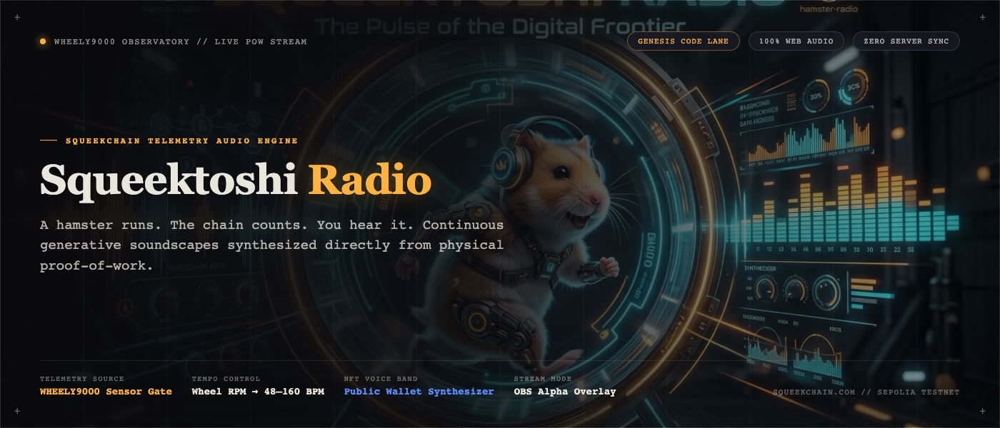

<p align="center">
  
</p>

# Squeektoshi-radio 🐹📻

squeekchain-project: 89cc8877-4a58-4b68-ac34-7b5d6e7149a3

> **Hamster-Powered Generative Music Station on Squeekchain PoW Telemetry**  
> Built for the Squeekchain *Genesis Code Lane* builder campaign.

Squeektoshi Radio turns the live WHEELY9000 hamster wheel into a continuous, generative music station running entirely inside the browser. As Squeektoshi runs on his wheel, the physical proof-of-work telemetry settles on the Sepolia Ethereum testnet. Squeektoshi Radio synthesizes this telemetry into an evolving soundscape: his wheel speed drives the tempo, his sleep turns the music into an ambient lullaby, completing blocks modulates the harmony, and every settlement rings a celebratory bell. Holders can enter their public wallet address to have their Squeek NFTs join the band as synthesized instruments.

---

## 🌟 Key Features

1. **100% Web Audio Synthesis (Zero Audio Files)**
   - All sounds (kick drums, high-pass noise hi-hats, triangle plucks, detuned pads, inharmonic FM bells, vibrato leads, and marimbas) are synthesized directly with the browser's native Web Audio API.
   - Built-in algorithmic stereo reverb convolver generated from pure noise envelopes.
   - Hearing safety: dynamics compressor + master gain hard ceiling at $\le 0.8$.

2. **Serverless Shared Listening**
   - Note selection and arpeggio permutations are evaluated using a deterministic Mulberry32 PRNG seeded by `(blockHeight, Math.floor(Date.now() / stepMs))`.
   - Independent listeners opening the stream at the same second hear the exact same melody without needing any WebSocket backend or relay server.

3. **Replay the Last 24 Hours (Feature 2)**
   - Scores the past 24 hourly buckets from `/v1/settlements?range=24h` as a deterministic 2-minute composition (5 seconds per hour).
   - Each hour's mood is categorized by daily work tertiles (0 or lowest third $\to$ sleep, middle $\to$ jog, top $\to$ zoomies).
   - Rhythmic density is scaled by `completedBlockCount`.
   - Interactive timeline scrubber with active hour highlights.

4. **Your Squeeks Are the Band (Feature 3)**
   - Paste any public Ethereum wallet address (read-only GET request, zero wallet connections or signatures).
   - Each Squeek NFT becomes an instrument voice assigned by level:
     - **Level 1**: Plucked acoustic guitar
     - **Level 2**: Inharmonic FM chime bell
     - **Level 3**: Woody marimba
     - **Level 4**: Detuned synth pad
     - **Level 5+**: Solo vibrato lead
   - Spatial panning derived from `(tokenId % 16)` across the stereo field.
   - Loudness proportional to `basePower` share, capped at the top 8 loudest voices.
   - Live visual card glow pulsing in real-time as each Squeek voice triggers.
   - Includes a **Demo Band** button for empty wallets or offline exploration.

5. **Background Waveform Visualisation (Full-Bleed Oscilloscope)**
   - The station acts as a precision measuring instrument: a full-bleed background canvas draws the master output as a 5-line ridgeline horizon (~2 seconds history).
   - 7 vertical audio lanes on the left edge (`KICK`, `BASS`, `LEAD`, `PAD`, `HARMONY`, `BELL`, and `BAND` when wallet is loaded) with real-time level ticks.
   - Traveling amber beat marker line and data-blue block progress threshold line.
   - Mood-reactive drift speed and waveform spacing (`sleep`, `jog`, `zoomies`, `unknown`).
   - Adaptive performance governor: DPR capped at 1.5, automatically downgrades if frame time exceeds 20ms, pauses when tab is hidden, uses pre-allocated `Float32Array` buffers (zero per-frame allocations).
   - Overlay mode (`?overlay=1`): single faint trace with transparent background.

6. **Honest Buffering State Machine**
   - Transparent, signal-driven station coordination across 6 explicit states: `idle`, `preparing`, `buffering`, `playing`, `unknown`, `error`.
   - 300ms debounce prevents visual flicker from transient network or audio scheduler jitter.
   - 0.6s smooth, reversible transition interpolation.
   - Honest, truthful cause readouts: *"Audio is struggling"*, *"Loading replay data"*, *"Loading Squeeks n of N"*, *"Waiting for the API rate limit"*.
   - Direct `aria-live="polite"` announcements for screen readers and assistive technology.

7. **Synthesized Sound-Effect Cues**
   - Delicate, purely synthesized UI audio cues using the Web Audio API (no external audio files):
     - `ignite`: quiet rising tick micro-sequence over 0.6s on Tune in.
     - `block`: soft two-note harmonic chime on block completion, tuned to key & scale.
     - `settle`: single dry high bell tap on settlement confirmation.
     - `ready`: single crisp high tick when buffering resolves.
     - `warn`: low double tick when buffering begins.
     - `seat`: micro-pluck panned by `(tokenId % 16)`, rate-limited to $\le 8/\text{sec}$.
   - Dedicated $-12\text{ dB}$ cue bus through a dynamics compressor limiter to prevent clashing.
   - Separate `CUES ON / OFF` toggle in station header, persisted in `localStorage`.
   - Muted by default in stream overlay mode unless explicitly enabled with `?cues=1`.

8. **OBS / Stream Overlay Mode (Feature 4)**
   - `?overlay=1`: Transparent background, removes station controls, renders an isolated now-playing ticker (mood badge, tempo, block, progress) and the rotating WHEELY9000 visualizer.
   - `?overlay=1&chroma=1`: Replaces transparency with `#00ff00` green for legacy chroma keying.

6. **Resilient Telemetry Client (Feature 5)**
   - In-memory `ETag` caching and `If-None-Match` 304 Not Modified handling.
   - Exponential backoff on HTTP 429/503 reading the `Retry-After` header.
   - 8-second request timeout via `AbortController`.
   - Preserves state when the API reports `"status": "unavailable"`, marking telemetry as `UNKNOWN` rather than zeroing values or muting the station.
   - Automatically pauses background polling when the browser tab is hidden (`visibilitychange`).
   - Plausible `?demo` mode for offline demonstrations.

7. **Accessibility & Polish (Feature 6)**
   - Respects `prefers-reduced-motion` by halting rapid wheel rotations.
   - Dark theme `#1a1a20`, Hamster gold `#f2b84b`, Squeek blue `#5b8cff`, dot-grid background.
   - Full keyboard navigation and high-contrast visible focus rings.
   - Dynamic `aria-live="polite"` regions for mood updates and signal status alerts.
   - Keyboard shortcuts: `Space` (Toggle Tune In/Out), `M` (Toggle Mute).
   - Responsive layout functioning down to 360px mobile viewports.
   - Transparent "How It Works" panel citing the sensor boundaries documented in [What the system proves](https://docs.squeekchain.com/security/proof-limits/).

---

## 🎵 Musical Telemetry Mapping Reference

| Telemetry Input | Musical Dimension | Mapping Logic |
|---|---|---|
| **Wheel Core Status** | Mood State | `IDLE` (or 0 RPM) $\to$ `sleep`<br>`ACTIVE`/`SPINNING` & RPM $< 60 \to$ `jog`<br>`ACTIVE`/`SPINNING` & RPM $\ge 60 \to$ `zoomies`<br>`stale` or `unavailable` $\to$ `unknown` (quiet fallback) |
| **Wheel RPM** | Station Tempo | $\text{BPM} = \text{clamp}(48 + \text{RPM} \times 1.4, 48, 160)$, quantized to multiples of 4 |
| **Squeek Block Height** | Root Key & Chords | $\text{Root Semitone} = \text{blockHeight} \pmod{12}$ above C3.<br>Seeded 4-chord progression loop advances on every completed block. |
| **Musical Scales** | Harmonic Palette | `sleep`: Minor Pentatonic (`[0, 3, 5, 7, 10]`)<br>`jog`: Dorian Mode (`[0, 2, 3, 5, 7, 9, 10]`)<br>`zoomies`: Mixolydian Mode (`[0, 2, 4, 5, 7, 9, 10]`) |
| **Block Progress Units** | Master Filter Cutoff | Exponential sweep from $350\text{ Hz} \to 10{,}000\text{ Hz}$ across the 1,000,000,000 block units. You can physically hear the station brightening as the block nears completion. |
| **Settlement Count** | Settlement Chime | Detected when `settlementCount` increments in hourly settlements $\to$ triggers inharmonic metallic FM chime bell once. |

---

## 🚀 Running Locally

Squeektoshi Radio has **zero runtime dependencies** and requires **no build step**. It runs as vanilla HTML5, CSS3, and ES modules.

### Option A: Using the built-in Node server
```bash
# Start server on http://localhost:3000
npm start
```

### Option B: Using any static file server
```bash
# Python 3
python3 -m http.server 3000

# or npx serve
npx serve -l 3000 .
```

Open your browser to:
- **Observatory 3D Landing Page**: [http://localhost:3000/](http://localhost:3000/)
- **Live Station Studio App**: [http://localhost:3000/app.html](http://localhost:3000/app.html)
- **Demo Mode**: [http://localhost:3000/app.html?demo](http://localhost:3000/app.html?demo)
- **Stream Overlay**: [http://localhost:3000/app.html?overlay=1](http://localhost:3000/app.html?overlay=1)

> **Important Audio Gesture Note**: Navigating between pages in any modern browser resets user audio permission. Therefore, clicking **Launch** opens `app.html` in an unmuted but idle audio state; audio playback intentionally begins only after an explicit click on the **Tune In** button on `app.html`.

---

### Keyboard Shortcuts & Professional Console
- `Space`: Tune In / Mute toggle
- `C`: Open / Close Professional Console Drawer (Mode selector, Sound palettes, Export clip, Shareable URL)
- `D`: Open / Close System Diagnostics & Telemetry Panel (FPS, Lateness, Voice count, Request tracker)
- `R`: Toggle 24-Hour Replay Day Panel
- `B`: Toggle Squeek NFT Band Panel
- `M`: Toggle Master Mute
- `Escape`: Close any active drawer or panel

### Diagnostic Report & Hardening
- Complete technical diagnosis and architectural analysis: see [`docs/DIAGNOSIS.md`](docs/DIAGNOSIS.md)
- Audio graph prewarming with `OfflineAudioContext` for instant (<150ms) start on gesture
- Audio node garbage collection via `.disconnect()` on `source.onended`
- Concurrency limiter (max 4 in-flight requests) and 429 jittered exponential backoff
- Master clock synchronization via `AudioContext.currentTime` with seek & pause
- 4 Sound Palettes with 1.2s crossfade: **Analog**, **Glass**, **Chamber**, **Dub**
- Orchestra mode featuring chord progression downbeats, counterpoint arpeggios, and chamber bells

---

## 🧪 Testing & Verification

The test suite includes pure mapping tests, replay determinism tests, API parsing tests, automated WCAG accessibility audits, audio scheduler drift measurements, and Playwright end-to-end tests:

```bash
# Run all unit tests (Node.js native test runner - 37 tests)
npm test

# Run Playwright end-to-end tests (mocked & live routes - 13 tests)
npm run test:e2e

# Run Axe WCAG 2.1 AA accessibility audit across all drawer states (0 violations)
npm run test:a11y

# Run audio scheduler lateness & drift benchmark (<25ms target)
npm run test:drift

# Generate the 1200x630 social card
npm run card
```

---

## 📺 Adding to OBS Studio as a Stream Overlay

1. In OBS Studio, add a new source: **Browser**.
2. Set the URL to your deployed URL or `http://localhost:3000/app.html?overlay=1`.
3. Set Width to `500` and Height to `180` (or resize as desired).
4. Check **Control audio via OBS** if you wish to route the radio station's audio into OBS's audio mixer.
5. (Optional) For chroma keying with green background, append `&chroma=1`: `http://localhost:3000/app.html?overlay=1&chroma=1`, then add a **Chroma Key** filter in OBS with Key Color Type: *Green*.

---

## 🌐 Deploying to Production

Because Squeektoshi Radio is a static site with no build requirements, deployment is instant on any static host:

- **Cloudflare Pages**:
  - Framework preset: `None`
  - Build command: *(leave empty)*
  - Build output directory: `.`
- **Vercel** *(Zero Configuration — Pre-configured via `vercel.json`)*:
  - Connect your repository to Vercel or run `vercel` in terminal.
  - Automatically configured:
    - Root output directory `.` with clean rewrites (`/app`, `/overlay`, `/demo`).
    - Optimized caching headers (fresh HTML revalidation, immutable assets, cached ES modules).
    - Permissive Audio & CORS headers for Web Audio and OBS overlays.
    - Lightweight `.vercelignore` to exclude local tests, tooling, and node_modules.
- **Netlify**:
  - Build command: *(leave empty)*
  - Publish directory: `.`

---

## ⚡ Converting to Next.js + TypeScript + Tailwind CSS

Yes, you can convert this project to **Next.js (App Router), TypeScript, and Tailwind CSS**!

### Important Campaign Rule Check:
> *The original Genesis Code Lane master prompt requested a zero-build static site with no mandatory bundler.*
> If you convert the project to Next.js for your own fork or portfolio, use Next.js Static Export (`output: 'export'`) so it still builds into pure static HTML/CSS/JS without requiring a Node.js server.

### Conversion Blueprint:

1. **Pure Music Engine (`src/music/*.ts`)**:
   - `mapping.ts`, `prng.ts`, `voices.ts`, `scheduler.ts`, and `replay.ts` are 100% pure JavaScript/TypeScript. They copy directly into Next.js with complete type definitions (`interface StatusData`, `interface Bucket`, `type Mood = 'sleep' | 'jog' | 'zoomies' | 'unknown'`).
2. **Audio & Window SSR Guard (`'use client'`)**:
   - Web Audio (`AudioContext`) only exists in the browser. In Next.js, add `'use client';` at the top of all audio-related components and initialize inside a `useEffect`:
   ```tsx
   'use client';
   import { useEffect, useRef } from 'react';
   import { AudioEngine } from '@/music/engine';

   export function Player() {
     const engineRef = useRef<AudioEngine | null>(null);
     useEffect(() => {
       engineRef.current = new AudioEngine();
     }, []);
     return <button onClick={() => engineRef.current?.start()}>Tune In</button>;
   }
   ```
3. **Tailwind CSS (`tailwind.config.js`)**:
   - Replace `styles.css` custom properties with Tailwind theme extensions:
   ```javascript
   module.exports = {
     theme: {
       extend: {
         colors: {
           brand: {
             bg: '#121217',
             surface: '#1a1a22',
             gold: '#f2b84b',
             blue: '#5b8cff',
           }
         }
       }
     }
   }
   ```
4. **Canvas Visualizer (`Visualizer.tsx`)**:
   - Bind canvas refs with `useRef<HTMLCanvasElement>(null)` and attach `VisualizerManager` inside `useEffect()`.

---

## 📄 License

MIT License. Built with ❤️ for the Squeekchain Community.
